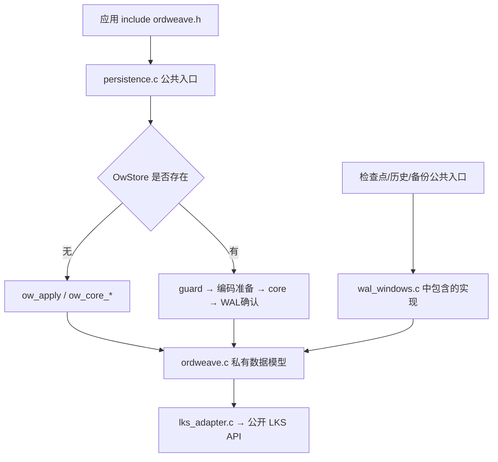
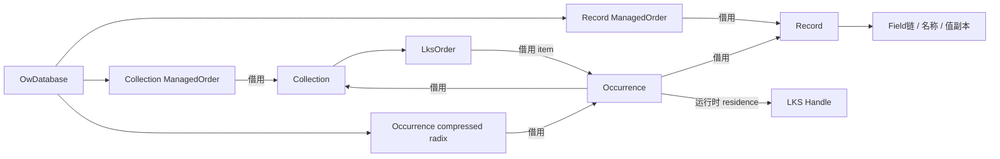
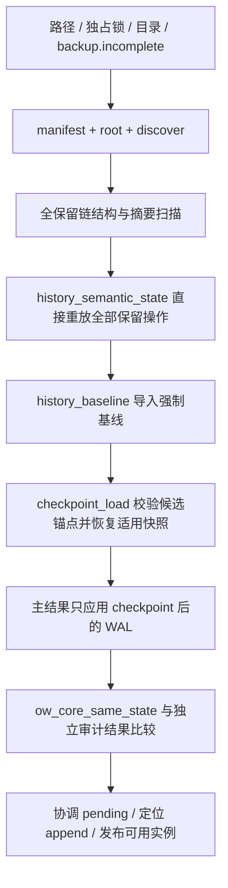

# OrdWeave v1.1.0：从公开调用到持久状态的实现导读

[中文入口](../README.zh-CN.md) · [先使用](USAGE.zh-CN.md) · [API](IMPLEMENTATION_API_REFERENCE.zh-CN.md) · [内部机制](IMPLEMENTATION_INTERNALS.zh-CN.md) · [验证证据](IMPLEMENTATION_VALIDATION.zh-CN.md)

本文按 **OrdWeave v1.1.0** 的实际源码组织，依赖 LayerKeySort Full4.2 `f751e1ee2afd682874281d6dc495969f9eca49eb`。技术契约不依赖候选发布名称；实际发布状态、版本字面量和准确来源见 [HANDOFF](HANDOFF.md)。

## 1. 四条边界先分清

1. 业务字段属于 Record，集合顺序属于 Collection，具体一次成员关系属于 Occurrence。
2. Record/Collection/Occurrence ID 是数据库分配的 uint64 身份；LKS Handle 是一次内存 residence 的借用指针，不持久化、不公开。
3. Revision 是逻辑数据状态的提交序号；checkpoint generation 是文件发布序号；root epoch 是恢复根发布序号。三者不能互换，也都不是时间戳。
4. LKS 负责顺序、比较器索引、原生快照；OrdWeave 负责数据、ID、复制、引用约束、WAL、文件协调、恢复、历史、备份。

Record 可以被 `[r1,r1,r1]` 三次引用，这产生三个 Occurrences，而不是把一条 Record 复制三份。动态移动针对某次出现。ID 数值顺序不等于 Collection 顺序。

## 2. 真实构建图

[CMakeLists.txt](../CMakeLists.txt) 构建六个生产翻译单元：`ordweave.c`、`lks_adapter.c`、`persistence.c`、`wal_format.c`、`wal_windows.c`、`sha256.c`。`OrdWeave::ordweave` 是静态目标别名，使用 C17/禁用扩展，链接 `LayerKeySort::layerkeysort` 和 Windows `bcrypt`。

`ordweave.c` 文本包含 `checkpoint_core.inc`、`occurrence_index.inc`、`field_index.inc`，让它使用同一翻译单元的私有 Record 等结构。`wal_windows.c` 先定义 OwStore 与文件帮助函数，再包含 `checkpoint_windows.inc` 和 `history_windows.inc`。`.inc` **不是五个独立 object 文件**，也不是可以单独给外部链接的插件。

上游 tests/examples/benchmarks/capacity-screen/install 都由父工程关掉。OrdWeave 的测试包含一个单独 OW_TESTING 库，不把全局故障钩子打开到生产库。详细目标地图见[开发指南](DEVELOPMENT.zh-CN.md)。

## 3. 从公开函数找到 core



`core_names.h` 在 core 源里把若干 `ow_*` 定义重命名为 `ow_core_*`。因此在 `ordweave.c` 看到 `ow_record_create` 的定义，不意味着它与 `persistence.c` 的同名公共函数重复链接。查行为要同时读重命名头、公共包装和 core，不能只用一次文本搜索断言函数冲突。

恢复对象在公开前尚未 attach 持久会话；`ow_apply` 调用 core，因此重放不会递归追加 WAL。内存 API 与恢复没有第二套字段/引用语义实现。

## 4. 谁拥有谁



三个对象单独分配，地址不随索引重建变化。Record 的 `refs` 是活 Occurrences 数，不是不同 Collection 或不同 Record 的数量。一个 Record 同集合出现四次，refs 加四。Collection 的 Order、两种 ManagedOrder 与压缩 ID 索引只借用对象地址，不能先 free 对象再删除借用。

销毁先清除字段缓存，随后销毁所有 Collection Order；再用对象内 `teardown_next` 临时链串出 Occurrences，销毁压缩索引页后释放对象；同样处理 Collections，最后 Records 与字段。`detach_index` 不做 LKS mutation，所以即使内部 Revision 到容量边界仍能销毁。每次销毁后的 Handle 都不再访问。

## 5. ID 索引不是替代排序树

Record/Collection 的 ID 唯一性仍由公共 ManagedOrder 保证，adapter 的比较器用 `(x>y)-(x<y)` 避免减法溢出，locate 的 pred/equal/succ 是三个独立输出。显式 Collection 顺序由公共 LksOrder 维护，不等于 ID 数值顺序。

Occurrence 全局查找使用 [occurrence_index.inc](../src/occurrence_index.inc) 的压缩16路 nibble radix：叶覆盖16个ID，内部节点只存实际分叉的前缀与shift；空跨度不按高水位分配。64位ID最多16层，查找不调用用户比较器或 LKS mutation。每个对象地址稳定，页只借用对象。顺序仍完全交给 LKS；这一私有索引不是替代排序引擎。内存随活叶与分支增长，稀疏 UINT64_MAX 不建立高水位数组。

字段索引是另一个显式可选的 ManagedOrder，按类型、值、永久Record ID排序，不能与永久Occurrence查找混为一谈。

## 6. 一次 Occurrence 插入的准备与发布

`ow_occurrence_insert` 先验证对象、placement/anchor、ID/Revision/refs容量，再分配稳定 Occurrence。`occ_prepare` 查重并准备最多一个新叶和一个分叉页，旧树此时不变；prepare失败只释放自有准备页。随后公共 LksOrder 插入；失败则 `occ_abort` 释放准备资源，旧索引/顺序/计数保持。成功后 `occ_commit` 仅写预定指针、计数，无分配/比较器/上游 mutation；最后 refs、ID高水位和 Revision 各按契约发布。

remove 先让 LKS 显式 residence 删除成功，再无分配地移除 radix槽，释放空叶并折叠单子分叉，然后 refs--/free/Revision++。不再构造替代的全局 ManagedOrder，也不靠可能分配失败的逆向回滚。move只改变原 Collection 的显式顺序，提前识别 self/邻接/端点 no-op，不改 radix。对应稀疏页、故障、容量及全局索引资源断言见 [failures.c](../tests/failures.c)。

## 7. 字段验证与复制是两个层次

`name_valid` 拒绝空名、过长名、非法 UTF-8；`value_valid` 检查类型、Bool 0/1、有限浮点、bytes指针与长度、字符串 UTF-8。UTF-8 解码拒绝无效起始/续字节、过长编码、代理项和大于 U+10FFFF 的码点。二进制不按UTF-8解释。

字段链由 `find_field` 按名字 `strcmp` 查找。`equal` 先比较 type，再比较具体值；String/Binary按size和memcmp；浮点用数值相等，所以 +0/-0相等。core 可能保留初次输入的 -0 bit pattern，但 WAL 编码归一化到 +0；保证的是相等语义，不能承诺内存与重开后的符号位恒等。

`copy_value` 复制payload；新增 Field 还分配节点与名字。所有必需资源准备完才连入链或替换旧值。替换先扣旧预算再检查新预算，公式为每字段 `17+strlen(name)+payload`。删除字段断链并只释放该节点。返回 get 再复制一次，因此后续覆盖/删字段不破坏旧返回结果。

## 8. Revision 与容量的发布位置

三个高水位都从0开始，成功分配counter+1；已删除ID的高水位不回退。`capacity` 同时检查数据库 Revision 与相应counter 是否 UINT64_MAX。数据 mutation 恰好一次 +1：创建、实际字段改变、删除、实际移动。读、相等覆盖、缺失字段remove和已满足位置move不增加。

需要避免“core成功 = 应用已获准观察持久化成功”的混淆。持久化 core 先增加内存 Revision，但包装层尚未输出成功；随后 append/flush失败就封锁实例，应用无法通过普通 query 观察并继续修改这个未确认状态。没有多操作事务，也没有公开可观察的事务中间状态承诺。

## 9. 把 ow_field_set 逐步走完

真实顺序由 [persistence.c](../src/persistence.c) 的 `mutate` 决定：

1. 公共入口把借用的id/name/value装入 `OwCommand`；检查db与会话guard。
2. 内存实例直接 `ow_apply`，没有文件操作或帧缓冲。
3. 持久化实例 `ow_store_enter`，先 `ow_encode`。这一层验证名称/值并分配确定性帧内存；尚未查 Record 是否存在，所以不存在ID也可能先有准备分配。
4. 读取core的before Revision，`ow_apply`调用core字段设置。此时才检查Record、相等no-op、预算和复制。
5. core失败：释放帧、leave，无WAL。core成功且after==before：同样退出，无WAL；这不等于整个no-op调用完全无分配。
6. 真正变化：`ow_store_commit`填header/Revision/prev digest，创建帧SHA和COMMIT03，必要时轮换段，精确append并 FlushFileBuffers。
7. 只有全部确认后 return OK。创建类操作的输出ID也只在最终OK时从局部command交给调用方。
8. hash/轮换/append/flush任一在内存应用后失败：poisoned=1，返回COMMIT_UNKNOWN。保留不确定性，不能盲目“回滚并再次create”。

public读取先清输出再检查guard，隔离时返回RECOVERY_REQUIRED。close仍可释放隔离实例；之后用新open重建事实。检查点/策略/根的发布不确定性使用RECOVERY_REQUIRED，不能统一包装成“操作没做”。

## 10. 确定性 WAL 编码与轮换

[wal_format.c](../src/wal_format.c) 使用 `ow_put/ow_get` 显式大端编码。Frame length与payload长度分开校验，header先SHA保护长度，再按界分配。字段编码包含name长度、type、value长度和完整值；String可含NUL。插入/移动保存永久Occurrence ID及placement/anchor，不保存指针或LKS私有路径。

创建类 command 最初ID为0，因为ID尚未发布；core成功后 `ow_store_commit` 将实际新ID写回payload，再计算最终摘要。这不是磁盘允许零ID；`ow_decode` 对重放payload中的零ID直接拒绝。

段目标64 MiB，帧上限16 MiB，不跨段。`new_segment` 写下一顺序号 `.pending` 的完整128字节header，刷盘关闭后无覆盖rename为`.wal`，然后打开新文件到header末。header携带Database ID、期望首Revision和前帧摘要，因此空的最终已发布段可表示中断轮换。详尽偏移仅以[WAL规范](PERSISTENCE.md)为准。

## 11. Windows 协调到底保证了什么

`safe_path` 执行UTF-8转UTF-16与路径组件检查；`open_file`拒绝最终reparse、目录文件与多硬链接文件。root/wal目录句柄不共享delete，活数据句柄同样防替换。writer.lock采用OS句柄和 `LockFileEx`，不是检查锁文件是否存在。

`write_exact` 循环处理部分WriteFile结果；零写和失败返回IO。`ow_sha256`每次打开BCrypt provider/hash，支持分段输入，统一done清句柄。FlushFileBuffers与write-through rename依赖底层存储合同，不提供硬件失约的魔法修复，也不是攻击者可改文件时的认证方案。

busy/poisoned只是控制流状态，不是跨线程同步原语。显式mutation和checkpoint使用enter/leave；其它维护链也依赖调用方完整串行化，不能推断所有入口都持有统一mutex。

## 12. Open：结构校验、语义审计和结果构造

`open_db`先分配空core，再经 `ow_store_open` 调用 `ow_store_open_internal`，最后成功才attach并输出。已有库的关键顺序是：



结构扫描检查段号/身份/首Revision/前驱摘要，帧magic、版本、header SHA、长度、帧SHA、COMMIT03、连续Revision及规范payload。它本身不证明“Record 99存在”。独立语义审计从genesis或已验证root基线起调用同一 `ow_apply`，实际应用每条保留操作；失败操作、ID不匹配、no-op帧都不能伪装成成功提交。

随后主结果可以恢复更新的native checkpoint，只应用其后的mutation。最终 `ow_core_same_state`直接比较计数器、Revision、Record字段/refs/预算、Collection顺序及Occurrence关联，不借checkpoint导出比较，因此没有把256 MiB检查点上限变成数据库总大小限制。它也不比较不同实例的Handle地址。

这意味着当前checkpoint并不消除全部语义重放成本，不能承诺整个启动一定变快。历史指南旧阶段的“只重放尾部”仅描述主结果构造，必须与独立审计区分。验证证据：`audit_oracle.py`独立重算所有摘要并把非法操作放到较新检查点之前；历史修正前该输入被接受，当前语义审计拒绝。

## 13. 不完整尾与已提交损坏不是一回事

短header只能在可见magic前缀正确时排除；完整header必须先校验自己的SHA与长度，才可把不足body判断为未完成。完整frame的摘要/边界错，即使在最后，也不是可忽略尾巴。中间段不完整不能跳过去读后段。

可写open的最后构造pass可用 SetEndOfFile 截到已验证边界并刷盘，后续append不会掩盖旧半帧。只读history/verify不做修复，发现需协调尾返回RECOVERY_REQUIRED。为可写open服务的语义审计副本可容忍同一未完成最终尾，但本身不截文件；实际修复仍归最终可写路径。

## 14. Checkpoint：对象和顺序分别是什么

`ow_core_export`先写固定header：身份、generation、Revision、三个高水位、WAL锚点、活对象计数。然后按ID顺序写Records；每条的字段临时按名字排序，复用字段mutation编码但去掉前导Record ID。Collections各写native snapshot，最后写Occurrence的ID/CollectionID/RecordID表和总SHA。

Snapshot namespace是 `dbid16 || collection8 || revision8 || generation8`。`cp_associate` 把Occurrence ID写到由调用者仍持有的8字节scratch，再由LKS立即复制。不能返回已经结束生命周期的回调局部数组地址。

导入先校验总长、格式、ID、SHA、计数与高水位，再建立所有对象。字段借 `ow_decode` 校验，core负责预算/复制。Occurrences先直接构造到未发布radix，此时没有Order residence；所有对象完成后才 `lks_snapshot_deserialize` 和 `lks_snapshot_restore_order`。`cp_resolve`检查8字节ID、存在性、所属集合以及`checkpoint_seen`去重。恢复成功才销毁原空Order、换入native order，并遍历写回每个Occurrence的新Handle。最后检查所有Occurrence恰好出现一次，再装回高水位与已提交Revision。

OOM或非法图的清理由未发布core的统一析构承担；不是把半个库塞给应用。详尽布局见[检查点规范](CHECKPOINTS.md)，资源步骤见[内部详解](IMPLEMENTATION_INTERNALS.zh-CN.md)。

## 15. 发布与候选选择

`ow_checkpoint_create`把健康会话置busy，捕获已提交Revision/digest，导出后 `cp_publish`：CREATE_NEW临时、write、flush、close、reopen、逐字节及导入验证、无覆盖发布不可变generation。然后构造OWSELECT，保存旧选择到bak，发布新current，发布同样新bak，最后才cp_cleanup/cp_sweep。

发布后重读失败不等于没发布。元数据不确定会poison并要求重开；清理阶段IO可能发生在新代已经生效之后。完整坏文件不会被改写成“好文件”。generation取现存最终/临时文件名与会话选择高水位的最大值+1，防碰撞；恢复选择则绝不单看最大文件名。

`checkpoint_load`优先校验两份选择及其WAL锚点。current/bak同generation但active条目矛盾是损坏；不同generation要有可验证连续性。缺失/损坏候选可退另一份或完整WAL；未来格式、硬IO、NOMEM不会被静默吞掉。使用已有root时，不能回退到已删除genesis，也不会选择早于root基线的普通检查点。可恢复open与严格verify的要求不同：verify还会拒绝缺副本或不一致的选择对。

## 16. 历史视图并不借用 live 数据

`ow_history_open`复制扫描会话参数，但使用新文件句柄和新core，`readonly_scan=1`、`limit_replay=1`、`through=target`。它重读manifest/root/策略，验证整链，确认目标范围，再做语义审计。若目标早于最新，审计先验证到最新，再从基线构造直接目标状态，不能因为“只读旧版本”就掩盖后续坏提交。

另一条主结果路径只挑不晚于target的检查点，重放到target，验证Revision并与直接目标状态比较。所有成功以后才分配OwHistory。返回后query直接访问这个私有core，不再查询live或磁盘。清理只销毁这个独立对象；返回值副本仍由调用者释放。

## 17. 保留根与物理删除

LastN的期望floor是 `current>=N ? current-N+1 : 0`。`history_boundary`检查各完整段的start Revision，选择满足 `start-1 <= floor` 的最新段，令 `start-1` 成为实际earliest。比如测试请求最近几版，实际得到35..41，WAL从9段减到2段；多保留一些是整段边界的安全选择。

`ow_history_cleanup`先处理已有根的必要协调，再verify实际内容。需要推进时：

```text
重建边界基线 → native checkpoint发布
 → 以 proposed root + retained suffix 重建当前并比较
 → history_selection将两份检查点选择收敛到新基线
 → 发布 recovery.current / recovery.current.bak
 → 重建新恢复路径并再次比较当前
 → 两根逐字节一致才能 history_delete_prefix
 → 清理已无引用的旧检查点 → 再verify并返回保证范围
```

Root记载基线身份/SHA/Revision、首段号/首Revision/前驱digest、发布时最新Revision/digest及epoch。原段不重编号，保留段不是伪造的新genesis。新根发布前不删旧前缀；两根间崩溃可验证较新路径但仍有旧材料；删除中断只留下范围外多余文件，后续显式cleanup可继续。epoch较大不是充分条件，真实材料仍须验证。

必需历史基线占最大三代之一。current/bak不能继续指向不可验证的旧祖先；先改选择再发布root。Manual/Forever不推进边界，但可以完成已经被旧操作判为过时的残留删除。policy、root、checkpoint各有不同的发布语义，不增加数据Revision。

## 18. Backup：先不可用，再独立验证，最后完成

`ow_backup_create`先verify源，检查绝对新目标、词法嵌套及父目录的volume-GUID规范路径，拒绝别名绕过的嵌套。创建wal/checkpoints和独立writer.lock，再创建刷盘的 `backup.incomplete`。

`history_copy_directory`只接受严格20位数字加期望扩展名，跳过规范pending；拒绝异常文件名后才格式化固定路径。每个文件用64 KiB缓冲精确拷贝并flush，复制相关选择/root/policy，最后复制manifest。注释中“manifest最后”指复制顺序；真正阻止半成品open的是incomplete标记，不能误说manifest单独就是完成证据。

私有 `ow_store_open_internal(...allow_incomplete=1)`只供备份自身验证；恢复全部状态、与源比较，再verify保留范围。关闭验证句柄后write-through rename为 `backup.complete`。普通open从不允许绕过incomplete标记。源关闭或移走后，备份仍有自己的文件与锁可继续写。失败清理只处理新目标，绝不触碰源数据；不承诺同盘灾难保护。

## 19. Verify、状态与释放的不同职责

Verify不是“当前内存可以读”的别名：它重新读根对、构造实际持久状态、检查选择对和所有引用快照，再重建earliest。它不调用自动修复，也不清理损坏文件。源guard隔离时先报恢复需求；根分歧也报RECOVERY_REQUIRED，显式cleanup才负责有证据的协调。

COMMIT_UNKNOWN的对象已经有潜在未确认内存变化，但常规访问被封锁；close释放并让下次open判定磁盘事实。checkpoint/root更新的IO则可能只剩旧路径，也可能新元数据已生效；要看published标记对应分支。不能用单一“失败原子”口号覆盖所有磁盘发布。

所有新输出初始化为安全状态不代表操作确定没发生。资源清理与业务撤销不同：释放实例、帧或临时view，不会撤销已经flush的commit。

## 20. 四条端到端阅读路线

| 场景 | 应按顺序打开的代码 | 直接证据 |
|---|---|---|
| create→set→commit→close→open | persistence.mutate → core field_set → ow_store_commit → open_internal/replay | persistence.c测试；使用示例lifecycle |
| checkpoint→tail→open | core_export → cp_publish → checkpoint_load → cp_resolve → replay → same_state | checkpoint.c、checkpoint_oracle.py |
| history→LastN→cleanup→anchored open | history_reconstruct_impl → history_boundary → history_selection/root → history_baseline | history.c、history_oracle.py、audit.c |
| backup→源不可访问→backup open | history_copy_directory → private open → same_state/verify → completion rename | history.c移动源目录后重开、audit.c |

表中 `persistence.c测试` 指 [tests/persistence.c](../tests/persistence.c)，不是生产包装器本身。精确功能/断言与运行证据见[验证地图](IMPLEMENTATION_VALIDATION.zh-CN.md)。更多helper直接调用关系见[内部指南](IMPLEMENTATION_INTERNALS.zh-CN.md)。修改实现前按[开发规则](DEVELOPMENT.zh-CN.md)复核；未解决成本放在[永久债务登记](TECHNICAL_DEBT.md)，不要把不支持的产品功能自动变成债务。

## 21. 未发布直接导入与调用内锚点复用

[checkpoint_core.inc](../src/checkpoint_core.inc) 仍通过 core 创建 Record/Collection、设置字段；Occurrence 则在未发布 core 中验证永久ID/所属关联/计数，分配对象并 occ_prepare/commit 到 radix，不逐个插入构造 Order。所有对象齐全后才反序列化 native snapshot，由 resolver 校验 namespace、Collection、唯一出现并恢复唯一 Order residence；遍历装回新 Handle，核对全部 seen、实际计数和最低构造 Revision，最后覆盖为文件内真实高水位与 Revision。失败时整个临时 core 析构，不向 live 发布部分对象。

[checkpoint_windows.inc](../src/checkpoint_windows.inc) 的 checkpoint_load 只在本次调用内保存最多6个已成功验证的 `(revision,digest)` 锚点，重复项复用成功结果；不是跨调用缓存，也不跳过候选文件验证、完整保留链校验或独立语义审计。因此减少重复工作不等于整个 open 只读尾部。

## 22. 字段索引和有序范围的完整执行链

公开 enable 先guard，再私下建立完整 ManagedOrder 和不可变深复制键；失败保留旧缓存。一个DB最多一个命名字段，预算是现存条目数及字段名含NUL+String/Binary复制payload，不包含固定元数据/LKS内存。成功相关 core mutation 后动态 remove/replace；失败清除索引及配置，成功数据操作仍成功，显式再次 enable 前只扫描。no-op、失败及无关字段修改保留有效缓存。

range 验证六类类型、名称、有限Float、匹配界限及两个0/1标志，选择匹配缓存或双扫描+公共 LKS Stable Sort；值升序、同值永久ID升序，复制ID数组。lower用ID0/UINT64_MAX哨兵而不做ID加一，避免跳过最大真实ID。历史range在独立core扫描，不借 live缓存。析构/exchange先清cache再释放旧对象；重开/回放/导入不自动启用，guard封锁提交不确定实例。完整错误及比较规则见[48函数参考](IMPLEMENTATION_API_REFERENCE.zh-CN.md#preview4-step15)。
